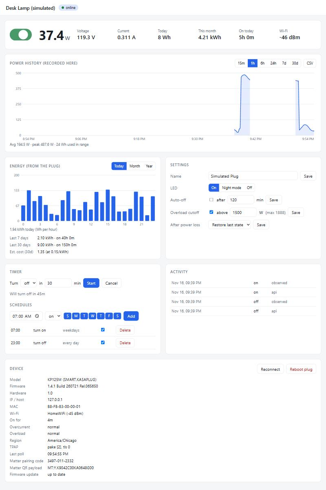
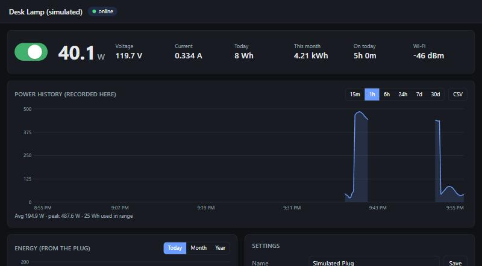
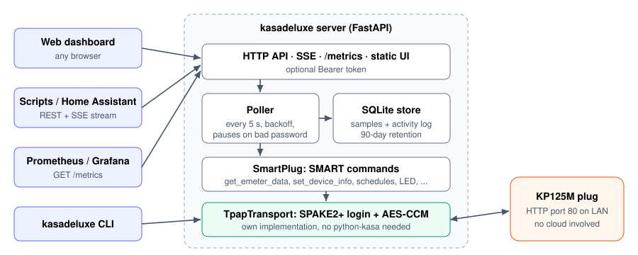
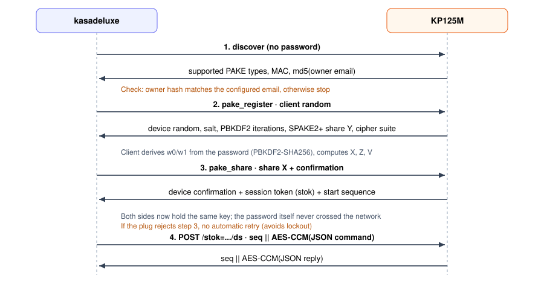
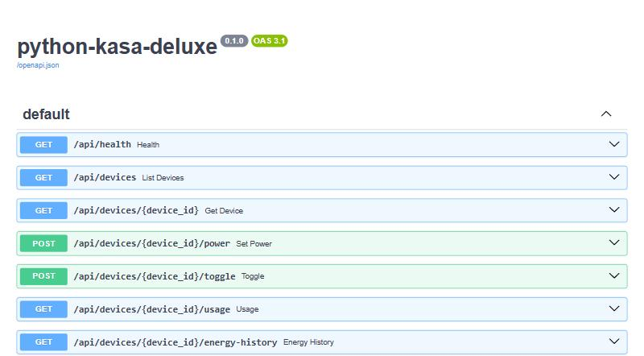

# python-kasa-deluxe: how it works

*Local control, live power monitoring and history for the Kasa KP125M smart plug.
No cloud and no Kasa app are involved, just your own server on your own network.*



---

## 1. Why this exists

The Kasa **KP125M** is a smart plug that also meters energy. Recent firmware (1.4.x)
moved it to a new local login scheme called **TPAP**. The popular open-source library
`python-kasa` doesn't support TPAP yet, so it can find the plug on the network but
can't log in to switch it or read its power meter. The only official options left are
the Kasa phone app, which goes through TP-Link's cloud, and Matter, which only exposes
on/off and basic readings.

**python-kasa-deluxe** fixes that with:

1. **A TPAP client of its own**, written from scratch in Python and based on the
   community's reverse-engineering work.
2. **A small server** that polls the plug every few seconds, stores every reading and
   offers a REST API.
3. **A web dashboard** for daily use, along with a command-line tool, a live event
   stream and Prometheus metrics for automation.

## 2. What you can do with it

| Area | Features |
|---|---|
| **Control** | On, off and toggle. Countdown timer ("turn off in 45 min"). Weekly schedules. Reboot. |
| **Live readings** | Watts, volts, amps, Wi-Fi signal, today's and this month's energy, runtime today. Pushed to the browser as they arrive. |
| **History** | Every reading stored locally (SQLite). Charts from 15 minutes to 30 days with averages, peaks and energy used. CSV export. |
| **Plug's own counters** | Hourly energy for today, daily for the month, monthly for the year, plus 7- and 30-day totals and a cost estimate. |
| **Settings** | Name, status LED (on, night mode, off), auto-off after N minutes, overload cutoff above N watts, state after a power cut. |
| **Integration** | REST API with interactive docs, server-sent events, Prometheus `/metrics`, a CLI, and a raw passthrough for any command the plug understands. |
| **Matter** | Shows the plug's Matter pairing code, so it can also join Home Assistant, Apple Home or Google Home alongside this server. |

The dashboard follows the system's light or dark theme:



## 3. Architecture



Everything runs as one small Python process (FastAPI + uvicorn):

- **TpapTransport** handles the secure login and encrypts and decrypts every message
  to and from the plug. If the plug drops the session (after a reboot, for example),
  it logs in again transparently.
- **SmartPlug** turns friendly calls like `set_on(True)` or `add_schedule(07:00, on)`
  into the plug's JSON commands. It batches up to five commands per round trip.
- **Poller** reads the plug every 5 seconds (configurable), writes the reading to
  SQLite, pushes it to every open dashboard and logs on/off changes. If the plug goes
  offline, it backs off gradually up to 60 seconds and recovers on its own.
- **Store** is a single SQLite file holding readings and an activity log. Old data is
  pruned after 90 days by default, and a 5-second poll uses about 1.5 MB per day.
- **API layer** serves the REST endpoints, the live stream, metrics and the
  dashboard. An optional API token protects it if you expose it beyond your own
  machine.

## 4. How the secure login works (TPAP)

TPAP is a **password-authenticated key exchange** (SPAKE2+, the same family of
protocol Matter uses). Both sides prove they know the password and agree on a fresh
encryption key, and **the password itself never crosses the network**, not even in
hashed form.



1. **discover:** the plug says which login methods it supports and gives an MD5 hash
   of the account that owns it. Before sending anything secret, kasadeluxe checks
   that this matches the configured account email.
2. **pake_register:** both sides exchange random values. The plug sends the salt and
   iteration count for stretching the password (PBKDF2-SHA256) and its half of the
   key exchange.
3. **pake_share:** kasadeluxe sends its half plus a proof. The plug checks it and
   replies with its own proof, a session token (`stok`) and a starting message
   counter.
4. **Encrypted session:** every command is then sent as
   `counter + AES-128-CCM(JSON)` to `/stok=<token>/ds`. Each message uses a new
   counter value, so replayed messages are rejected.

For the KP125M, the "password" in this exchange is your **TP-Link / Kasa app account**
email and password. The plug checks them locally. No internet connection is needed.

### Lockout protection

The plug locks itself after several wrong passwords, so kasadeluxe is deliberately
careful:

- It stops after **one** rejected password. Polling pauses and the dashboard shows a
  banner instead of retrying in a loop.
- It refuses to try at all if the plug reports a different owner account.
- You resume with the **Reconnect** button, or with `POST /reconnect` and corrected
  credentials, once the config is fixed.

## 5. Using it

### Setup

```bash
python -m venv .venv
.venv/Scripts/pip install -e .          # Windows (use .venv/bin/pip on Linux/macOS)
cp config.example.toml config.toml      # then edit: plug IP + TP-Link account
kasadeluxe serve                        # open http://127.0.0.1:8125
```

```toml
[account]
username = "you@example.com"
password = "..."

[[device]]
id = "plug"
host = "192.168.1.50"   # the plug's IP; give it a DHCP reservation
name = "Desk Lamp"
```

The machine running the server needs to reach the plug on port 80, so in practice it
should be on the same home network.

### Command line

```text
$ kasadeluxe discover --host 192.168.1.50      # no password needed
{ "pake": [2], "tls": 0, "dac": true, "mac": "<plug-mac>",
  "owner": "<md5 of owner email>", "passcode_type": "userpw" }

$ kasadeluxe power
{ "on": true, "power_w": 47.8, "voltage_v": 119.9, "current_a": 0.398,
  "today_wh": 8, "month_wh": 4208, "today_runtime_min": 300, "rssi": -50 }

$ kasadeluxe off
$ kasadeluxe raw get_device_usage
```

### REST API

Interactive docs are built in at `/docs`:



```bash
API=localhost:8125/api/devices/plug
JSON='content-type: application/json'

# switch off
curl -X POST $API/power -H "$JSON" -d '{"on": false}'

# turn off in 45 minutes
curl -X POST $API/countdown -H "$JSON" -d '{"seconds": 2700, "on": false}'

# weekdays at 07:00, turn on (week_days bitmask: bit0 = Sunday ... bit6 = Saturday)
curl -X POST $API/schedules -H "$JSON" \
     -d '{"minute_of_day": 420, "on": true, "week_days": 62}'

# last hour, 60 points, with energy used
curl "$API/history?hours=1&points=60"
```

| Endpoint | Purpose |
|---|---|
| `GET /api/devices/{id}` | Status, latest reading, device info |
| `POST /power`, `/toggle` | Switch the relay |
| `GET /history`, `/history.csv` | Locally recorded readings |
| `GET /energy-history?period=day\|month\|year` | The plug's on-board counters |
| `GET /settings`; `PUT /led`, `/auto-off`, `/protection`, `/name`, `/default-state` | Settings |
| `POST/DELETE /countdown`; `GET/POST/PATCH/DELETE /schedules` | Timers and schedules |
| `POST /raw` | Any plug command, e.g. `{"method": "get_wireless_scan_info"}` |
| `GET /api/stream` | Live server-sent events |
| `GET /metrics` | Prometheus |

### Monitoring

```text
kasa_power_watts{device="plug"} 47.832
kasa_voltage_volts{device="plug"} 119.111
kasa_current_amps{device="plug"} 0.398
kasa_energy_today_wh{device="plug"} 8
kasa_relay_on{device="plug"} 1
kasa_up{device="plug"} 1
```

Point Prometheus at `/metrics` and build a Grafana dashboard, or let Home Assistant
read the REST API.

## 6. Testing and status

- **12 automated tests** cover the key-exchange maths on every supported curve,
  password-hashing vectors checked against OpenSSL, the full encrypted session,
  automatic re-login, the whole REST API, token auth, and the rule that a wrong
  password is never retried.
- A **built-in plug simulator** (`python -m kasadeluxe.simulator`) speaks TPAP like a
  KP125M. It's how the screenshots in this document were made, and you can try
  everything without hardware.
- **Not yet verified against a physical KP125M.** The protocol follows the
  community's reverse-engineering of real devices, but the simulator shares the same
  crypto code, so the first run against a real plug is the true test. If login fails,
  the `discover` output is the first thing to look at.

## 7. Credits and license

The TPAP handshake is based on reverse-engineering work by ZeliardM in python-kasa
[PR #1592](https://github.com/python-kasa/python-kasa/pull/1592), with background from
[python-kasa#1590](https://github.com/python-kasa/python-kasa/issues/1590) and
[kasa-rs#20](https://github.com/cmackenzie1/kasa-rs/pull/20). Because python-kasa is
GPL-3.0, this project is released under **GPL-3.0-or-later**. Not affiliated with
TP-Link.
